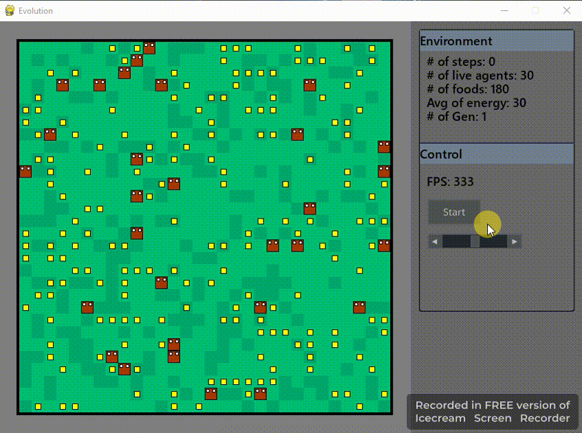
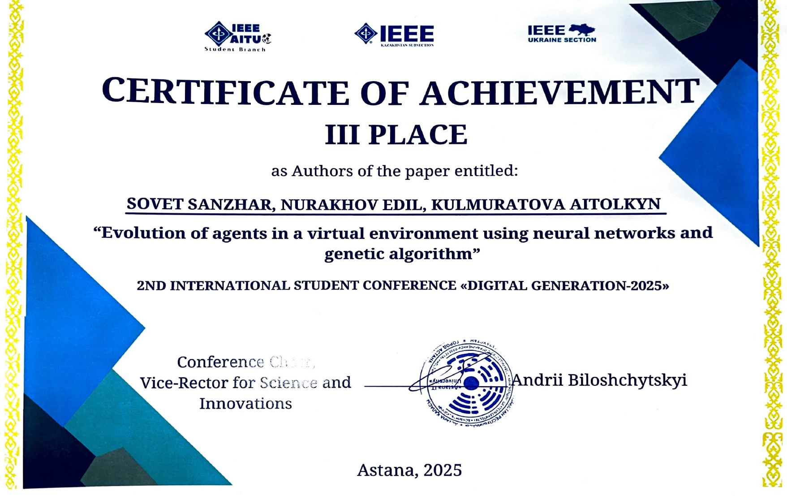

# Digital-aquarium

Этот проект представляет собой Reinforcement learning model, с децентрализованно мультиагентной, дискретной средой и агентами в виде простой нейросети.
Для обучения этой нейросети используется классический генетический алгоритм.

III место на 2025 IEEE AITU: Digital Generation

Sovet Sanzhar, Nurakhov Edil, Aitolkyn Kulmuratova, Evolution of agents in a virtual environment using neural networks and genetic algorithm

Подробное описание проекта — [Thesis.pdf](python_project/assets/Thesis.pdf).





## Запуск через uv

Требуется [uv](https://docs.astral.sh/uv/getting-started/installation/).
Проект использует Python 3.12; uv создаёт окружение `.venv` в `python_project`.

Из корня рабочей папки:

```bash
cd python_project
uv sync --locked
uv run main.py
```

Зависимости описаны в `python_project/pyproject.toml`, точные версии закреплены
в `python_project/uv.lock`. На текущей машине нет GPU, поэтому используется
`torch==2.6.0+cpu` из CPU-индекса PyTorch. Вариант с CUDA 12.6 для будущей
машины с NVIDIA GPU оставлен в комментариях в `pyproject.toml`.

Приложение открывает окно pygame. При запуске по SSH нужен X11-проброс;
для запуска без экрана можно использовать `xvfb-run uv run main.py`.

LaTeX-документы находятся в `latex_documents/`.
